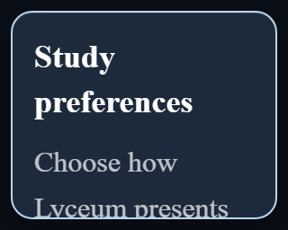
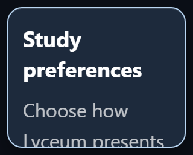

# M0-003: portalled Dialog font polish — before/after evidence

This is the **separate Dialog typography follow-up** after Tooltip [PR #7](https://github.com/hyvvs/lyceum/pull/7) merged at `72afbc3f652c4e1800b7f3e130f803f2d7156b30`. It does not alter Dialog's public API, theme recipes or glass/fallback semantics.

## Reproduced defect and fix

- **Before:** the Storybook stage computed `Poppins, Inter, ui-sans-serif, system-ui, -apple-system, "Segoe UI", sans-serif`; the separately portalled Dialog title, description and body computed **`"Times New Roman"`** (browser serif fallback). A new Playwright regression failed on the baseline's default Storybook state with this exact mismatch.
- **After:** a single `font-family: var(--font-sans)` declaration on the Dialog surface gives the content, title, description and body the **same computed Lyceum stack as the stage** across dark, light, high contrast and genuine 200%-text zoom. No font files or runtime dependencies were introduced. The computed stack is verified; actual face resolution on other operating systems is not.
- Playwright checks that Radix's Dialog remains **outside the stage in a portal**, remains inside the viewport at 320×256, wraps long guidance without horizontal page/body overflow, scrolls via keyboard, keeps modal focus, closes with Escape and restores focus to the action. Existing axe checks run on the expanded modal and all Dialog Storybook states.

## Viewport-only screenshot comparisons

Every capture is real Chromium output from the same Storybook story and viewport, with the modal open and animations disabled for reproducibility. No image is a mockup, and the baseline was captured **before** the CSS fix.

| Story | Before (merged main) | After (polish branch) | Viewport |
| --- | --- | --- | --- |
| Dark | [Before](dialog-before-dark.png) | [After](dialog-after-dark.png) | 800×520 / 100% |
| Light | [Before](dialog-before-light.png) | [After](dialog-after-light.png) | 800×520 / 100% |
| High contrast | [Before](dialog-before-high-contrast.png) | [After](dialog-after-high-contrast.png) | 800×520 / 100% |
| Dialog 200% text | [Before](dialog-before-zoom.png) | [After](dialog-after-zoom.png) | 320×256 / 200% |
| Full long-hint Dialog 200% text | [Before](dialog-before-long-hint-zoom.png) | [After](dialog-after-long-hint-zoom.png) | 320×256 / 200% |

### 200%-text visual comparison

| Baseline serif fallback | Fixed Lyceum sans |
| --- | --- |
|  |  |

At 320×256 and 200% text, the dialog is **intentionally internally scrollable**, so the screenshot shows only its first visible portion. The complete guidance, keyboard scrolling and focus behavior are tested separately; do not treat that cropped initial view as lost content.

## Reproduce

1. From merged `main` at **`72afbc3`** (before the one-line font fix), run `corepack pnpm install --frozen-lockfile` and `corepack pnpm storybook:build`.
2. Start a local preview: `corepack pnpm exec vite preview --outDir storybook-static --host 127.0.0.1 --port 6006 --strictPort`.
3. From another terminal run `node docs/qa/dialog-portal-font/capture.mjs before`. The script expects `http://127.0.0.1:6006` and prints the computed title/description/body and stage font stacks. The script is added in this polish branch; to reproduce from a clean baseline use its copy from this PR without copying the production CSS change.
4. Stop the preview; switch to the polish commit, rebuild Storybook, restart the same preview and run `node docs/qa/dialog-portal-font/capture.mjs after`. Compare the paired PNGs and reported computed fonts.
5. Run `corepack pnpm verify`, `corepack pnpm audit`, `corepack pnpm storybook:build` and `corepack pnpm test:ui`. The new regression is in `tests/ui/dialog.spec.ts`.

## Scope boundaries and visual acceptance

These are **opaque Dialog reading surfaces**, where legibility and high-contrast fallbacks take priority. They do **not** establish full-glass design acceptance, photograph-backed contrast, WCAG compliance across every combination, true Poppins font availability, or Safari/WebView/WebKitGTK frame budgets. The non-negotiable `docs/18` and `ADR-0008` visual goals (translucent frosted glass, atmospheric backdrops, floating navigation/icon dock, tints, motion and solid fallbacks) are tracked through M0-003 and dependent M0-017 to M0-020 rather than being silently declared finished by this narrow polish PR.
