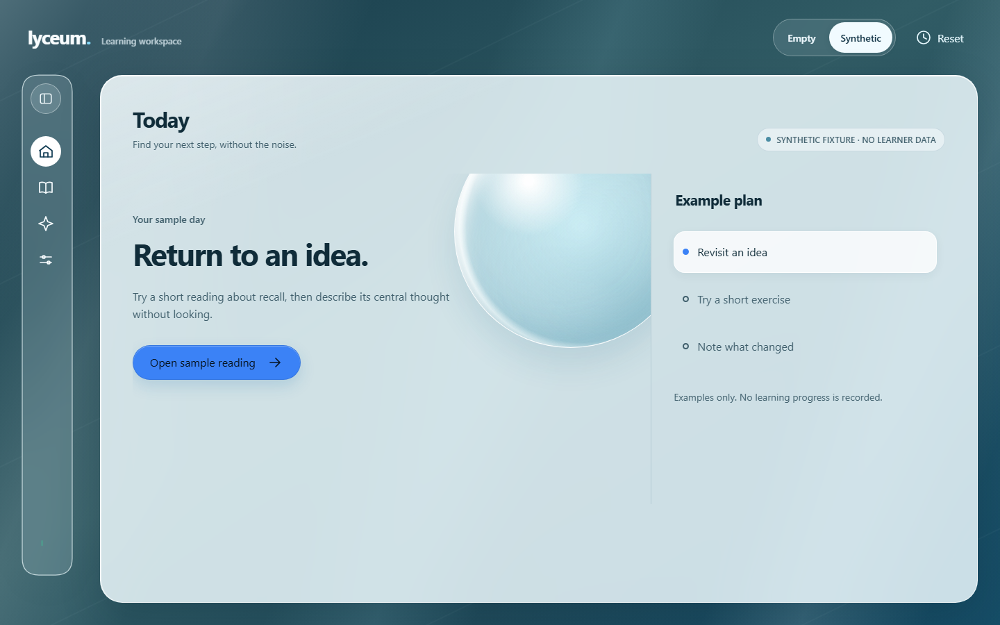
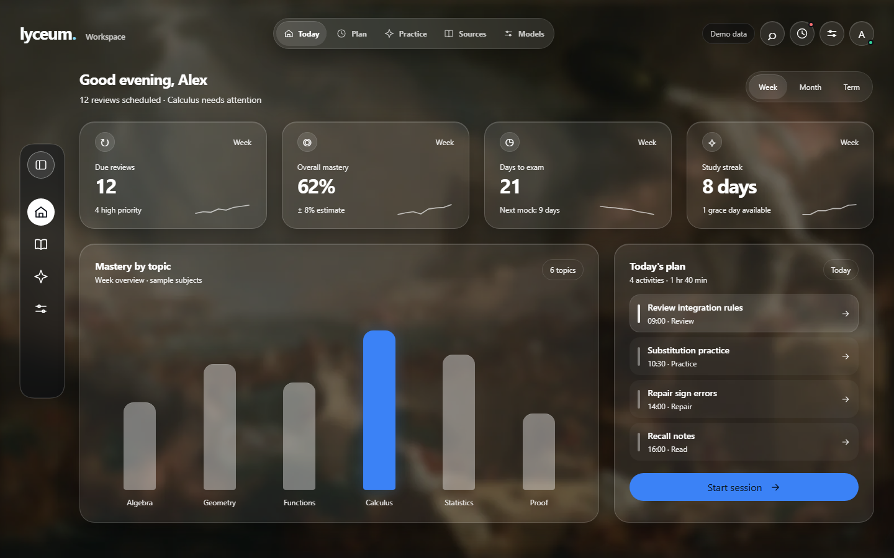

# M0 UI fidelity — owner-directed Today screen review

**Branch:** `m0/ui-fidelity`. **Scope:** opt-in synthetic Storybook Today screen and QA scripts only; not the ordinary product router, accepted Windows/macOS Tauri security, stored learner data or release. PR #33 remains its separate open draft, not merged. This work has **not** received owner aesthetic acceptance.

## Exact current-source screenshot comparison — 1440 × 900

| Before — committed Crystal Desk | After — dark floating Today |
|---|---|
|  |  |

Both were captured with actual Chromium rendering at exactly **1440 × 900**, device scale 1, using the synthetic-Today Storybook route. The baseline was captured **before** the source rewrite and is intentionally not regenerated. The new screenshot and [hover screenshot](after-hover-1440x900.png), [visible dock tooltip](after-dock-hover-1440x900.png), [390 × 844 mobile](after-mobile-390x844.png), [1440 × 900 RTL](after-rtl-1440x900.png), [light + solid fallback](after-light-solid-1440x900.png) and [full-speed interaction loop](after-navigation-loop.webm) were captured **after** the actual source rebuild. The WebM recording preserves animation and interaction without animation-disabled capture; encoding rate is **not** a measured renderer FPS budget.

Repeat the final screenshot and navigation capture with:

```powershell
corepack pnpm storybook:build
node scripts/capture-m0-ui-fidelity.mjs after
```

The `before` capture is immutable historical evidence from the immediately preceding source version. It can only be recaptured against that historical source.

### Verified on the current working-source snapshot

- `corepack pnpm verify`: **PASS**, including 505 Vitest passes (one historical skip), 29/29 executable deterministic evaluation rules (30 qualitative scenarios remain incomplete), typecheck, lint and boundaries.
- `corepack pnpm storybook:build`: **PASS**, real compiled Storybook assets.
- `corepack pnpm exec playwright test tests/ui/m0-005-reference-prototype.spec.ts --workers=1`: **15/15 PASS**. No axe rule/tag was disabled. Thirteen settled story variants plus mobile have zero tagged reported violations but `aria-prohibited-attr`, `color-contrast`, `label-content-name-mismatch` remain **incomplete**.
- `corepack pnpm exec playwright test --workers=4`: **154 passes, one historical skip**, with an isolated output directory and no concurrent Playwright process. Two preceding overlapping attempts had `ENOENT` trace-artifact failures; one intermediate compiled Storybook test was stale after adding a dev-only badge. Those failed attempts remain in ignored local logs rather than being misrepresented as green.
- `corepack pnpm web:build`: **PASS**; QA fixture remains outside ordinary production routing/bundling.
- `corepack pnpm audit`: **PASS**, no known JavaScript vulnerabilities.

## Scored `docs/20` rubric — self-assessment with actual screenshots

The after image was opened and inspected against `docs/design-reference/reference-home.png`, the transition PNG and the initial split comparison. **Provisional 17/20, no zeros.** This meets the mechanical *self-scoring threshold*, **not** a claim of an exact visual match, independent owner acceptance, WCAG certification or reference-video parity.

| # | Brief criterion | Score | Direct evidence and limitation |
|---|---|---:|---|
| 1 | Photographic backdrop with depth | **1/2** | Full-bleed pre-blurred, licensed artwork clearly provides structure through panels; the owner-supplied Thomas Cole **painting is not a photograph**, and its dark blur obscures some historical detail |
| 2 | Dark, mostly transparent glass | **2/2** | Stat/plan/chart backgrounds use token glass fill around 7%, 24px blur, visible art under each panel, soft border/highlight |
| 3 | Multiple separate floating panels | **2/2** | Four equally sized metric cards, distinct chart and plan areas; genuine gaps, no single milky work-plane |
| 4 | Top nav and round control cluster | **2/2** | Centered Today/Plan/Practice/Sources/Models pill, right search/bell/settings/avatar with indicator dots; functional navigation/popovers |
| 5 | Icon dock, white active disc, tooltip | **1/2** | Icon-only floating capsule, white selected disc, Sources hover tooltip in actual screenshot, interruptible navigation; still roughly **72px**, wider than the brief's 56px, and retains existing expandable rail geometry |
| 6 | Dense, plausible demo information | **2/2** | Four example metrics/sparklines, six-topic chart, four session rows and working Start session; synthetic only, never real learner statistics |
| 7 | Single focal accent | **2/2** | Only selected Calculus bar and the primary Start session share purposeful cobalt; remaining panels neutral |
| 8 | Typography and backdrop contrast | **2/2** | 24px greeting, compact type and 28–32px values; conservative offline worst-case sampled estimate **5.41:1** for 90%-white secondary text over the **8px pre-blurred asset**, 58%-black scrim and 7%-white panel fill; no per-pixel physical/AT certification |
| 9 | Plain copy and hidden scaffolding | **2/2** | Removed sphere and slogans; no Empty/Synthetic toggle, Reset or fixture badge in visible chrome; a small **Demo data** chip remains at desktop and mobile; developer controls require `Ctrl+Shift+D` |
| 10 | Purposeful motion and reduced motion | **1/2** | Existing connected, interruptible rail spring; chart bars animate once; card hover lifts 4px, recorded navigation loop and motion-off fallback. No metric count-up or full reference-sequence timing validation |
| **Total** | | **17/20** | **Provisional only** |

The independent read-only screenshot pass *before* final accessibility/fallback changes rated the intermediate screenshot **15/20**. This later 17/20 number is **self-assessed**, not a second independently confirmed score. No mechanical comparison can establish the owner's subjective acceptance.

## Five remaining visible differences

1. The provided *Destruction* painting is not the reference's photographic architecture/window scene. Its blur/scrim preserve textual legibility at the cost of obvious visual structure.
2. The existing spring-connected morphing rail uses an approximately 72px collapsed capsule, rather than the specified 56px single-purpose dock.
3. The reference has extra peripheral detail (an Export action, delta pills and chart guidance); the new Today prioritizes functional actions instead of inert decorations.
4. The contrast-driven backdrop scrim is ~58%, rather than the brief's approximate 40%, to retain a conservative text contrast margin on bright art.
5. Motion has bars, hover lift and the spring navigation, but lacks numeric count-up, per-card stagger and authenticated original-clip timing parity.

## Privacy, asset and accessibility disposition

- **Synthetic labels:** all metrics and names in the demo route are fixture-only. The honest Empty Today route shows dashes and an unsaved learning-goal input; neither history nor metrics are persisted or transmitted. `Ctrl+Shift+D` opens the keyboard-accessible development toggle panel; `Escape` and Close restore focus.
- **Image/license:** `packages/ui/assets/backdrops/cole-course-of-empire-preblur.webp`, derived offline from the public-domain 1836 Thomas Cole painting, 1600×993, ~20.7KB WebP; see `packages/ui/assets/backdrops/LICENSE.md`. The complete source JPEG stays in ignored `.git/`, not staged. The owner-supplied image in chat is of the same artwork. No reference-video bytes or `docs/design-reference` screenshots are used as runtime assets.
- **Contrast calculation:** local PIL model conservatively samples the full preblurred WebP and compares its blended pixel background (58% scrim, 7% glass fill) with 90%-white text. Lowest found **5.413:1**. This estimate omits physical compositor effects and composited glyph antialiasing; `axe` still reports **incomplete** contrast and ARIA checks.
- **A11y:** actual Playwright variants (including RTL, 200% text, opaque, high contrast, light+solid, off/reduced motion, desktop and 390px mobile) exercise navigation, focus and dock clearance. Native assistive technology, transient-frame contrast, real GPU/blur cost, first-painted-frame, installer/security/legal certification and owner review remain open.
- **Production isolation:** this branch's implementation is confined to the opt-in Storybook fixture, CSS, evidence/capture scripts and docs. Normal web/PWA build does not bundle or route to the fixture. No new provider, persistence or network calls.

**Hold gate:** do not merge the fidelity branch or Draft PR #33, do not ship a QA-only desktop executable, and do not advance M0-007 solely because this rubric is self-scored above threshold.
