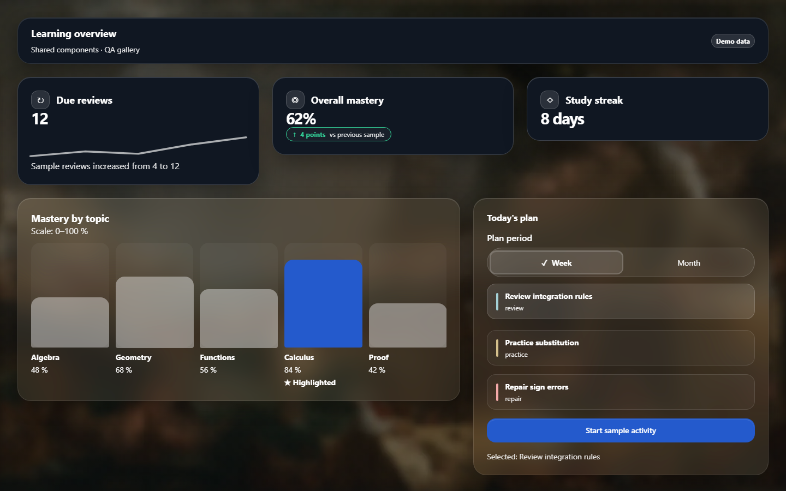
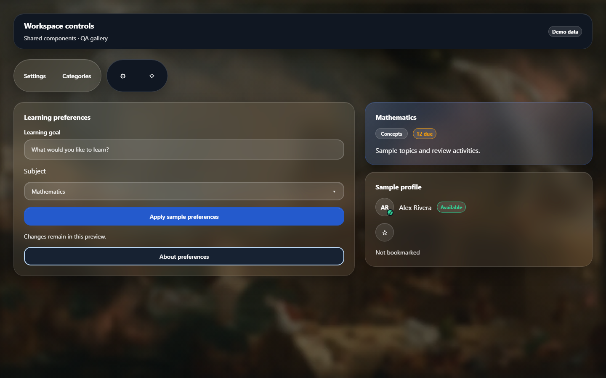
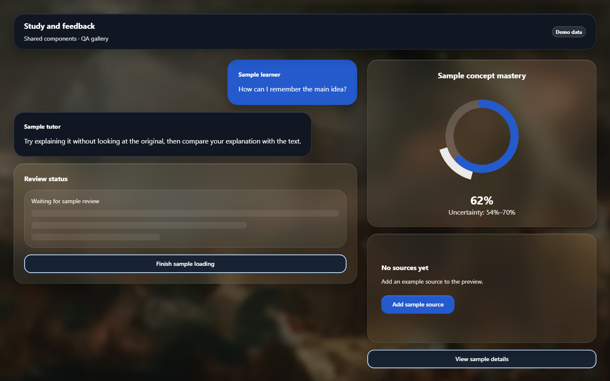

# Shared liquid-glass components — fidelity phase 2/3

**Scope:** `m0/ui-fidelity` opt-in Storybook QA and shared UI styles. No production routing/credential/persistence provider changes; the ordinary production web build deliberately does **not** include the QA backdrop. This is a **shared-component gallery**, not a new tutor screen and not an assertion of owner aesthetic acceptance or authenticated V5/V10 layout match.

## Actual independent 1440 × 900 Chromium captures

| Overview | Controls | Feedback |
|---|---|---|
|  |  |  |

Full-speed uncropped page-entrance videos: [overview](screens/shared-overview-entrance.webm), [controls](screens/shared-controls-entrance.webm), [feedback](screens/shared-feedback-entrance.webm). The media were generated **after** building the current Storybook source; the captures were actually inspected visually. Encoding fps does not prove compositor FPS.

## What is centralized

The established Today material tokens now live in `packages/ui/src/glass.css`: 8px *offline* backdrop preblur, brightness factor 1, `rgb(8 10 16 / .58)` scrim, `rgb(255 255 255 / .07)` material fill, 24px glass blur, 14% white rim highlight, 140% saturation, one deep `#245acc` button blue with `#fff` text (verified **6.16:1** white-on-blue). The specific Thomas Cole artwork URL stays in the Storybook-only CSS; the production bundle was checked for leakage. In the light theme the semantic positive/caution/danger/concept colors are darker and all exceed **5.6:1** against `#f5f8fc`.

The preexisting GlassPanel, GlassCard, TintCard, StatCard, BarChart, PillNav, Dock/MorphingRail, RoundIconButton, SegmentedControl, Tabs, Button, Select, Dialog, Tooltip, Toast, ChatBubble and MasteryRing retain their accessible semantics and now share controlled crystal materials, selected/hover contrast, accent discipline and solid/reduced/high-contrast/forced-colors fallbacks. The shared Dock is 56px, with a 40px active disc and transform-based transition, a per-link solid selected fallback when CSS `:has` is unsupported or a navigation list exceeds 12 links.

Seven **new actual shared component modules** have Storybook stories: ListRow with mode marker, Input, Popover (portalled viewport-collision placement), Chip/Badge, Avatar, SkeletonLoader, EmptyStateCard. All are exported from the shared index. The Popover has tested Enter, Space, Escape, first actionable control focus, focus return and clipping at 1440×900, scrolled RTL desktop, and 320×256 with 200% text. The Avatar rejects remote URL schemes and marks online/busy/offline by shape as well as color. The Skeleton fades opacity and honors reduced motion.

## Validation and known limits

| Check | Current result |
|---|---|
| `corepack pnpm verify` | **PASS** (existing 505 unit tests plus four fidelity-token checks; 29/29 deterministic rules; 30 qualitative scenarios still incomplete) |
| `corepack pnpm storybook:build` | **PASS**, 25 primitive families with 465 generated Storybook entries |
| `corepack pnpm exec playwright test --workers=4` | **PASS**: 164 passed, one historical skip, 1.6min (isolated artifacts) |
| Fail-closed axe gate | **PASS**, `unique_stories=465 required_states=503 executed_states=503`; 64 enabled A/AA rules per scan, no rules disabled |
| `corepack pnpm web:build` and production QA isolation | **PASS** |
| `corepack pnpm audit` | **PASS**, no known JS vulnerabilities |
| Independent read-only `lyceum-ux-review` | **Done**: source and three actual gallery renders examined; found and prompted real dock/popover/light semantic/focus corrections |

The UX reviewer initially found off-screen Popover placement on scrolled desktop, unprotected Dock indices, inadequate light-theme semantic text contrast and focus instability in feedback. These were corrected and regression-tested. **Still unresolved:** all machine-incomplete axe findings (principally color contrast and some ARIA), physical human assistive technology and 200%-text on native Windows/macOS, real-world compositor/transient contrast, blur/GPU cost, installer/legal notice and the owner's aesthetic judgment. No reference-video exact-parity or production acceptance is claimed.

The 10-criterion `docs/20` rubric applies to **each product screen**, not to this component gallery. Scoring the gallery as a successful 17/20 *screen* would be misleading. Each of the eight requested screens will instead have its own genuine 1440×900 capture, section-by-section rubric, up to three iterations, verification and a dedicated commit, in the required order.

**Owner gate:** do not merge `m0/ui-fidelity`, mark Draft PR #33 ready, publish a production build, or advance M0-007 without separate explicit acceptance.
